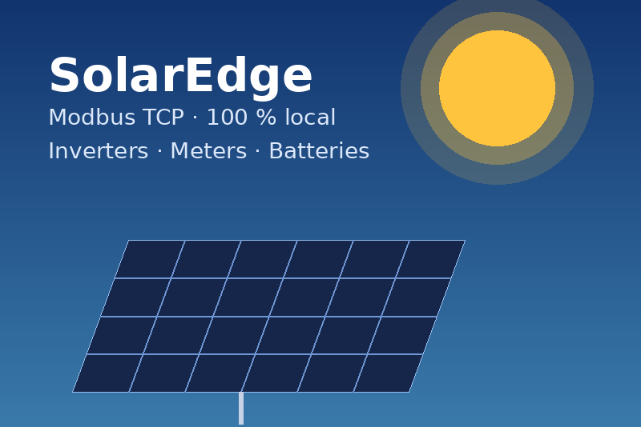

# SolarEdge (Modbus) for Gladys Assistant



External integration for [Gladys Assistant](https://gladysassistant.com) that
reads SolarEdge inverters, meters and batteries **locally over Modbus TCP**: no
SolarEdge account, no cloud, a reading every few seconds.

🇫🇷 [Documentation en français](docs/fr.md) · 🇬🇧 [English](docs/en.md) ·
🇩🇪 [Deutsch](docs/de.md) · 🇪🇸 [Español](docs/es.md)

## Features

- **Devices**, detected automatically behind the configured inverter:
  - inverters (leader/follower supported): production (W), production index
    (kWh), AC voltage and current, temperature, status;
  - grid meter: signed grid power, import/export indexes, computed house
    consumption — consumption meters are supported too;
  - StorEdge batteries: charge level, charge/discharge power and indexes,
    available energy, temperature, status.
- **Scene triggers**: inverter status changed, solar surplus (threshold with
  hysteresis), battery status changed, connection lost/restored.
- **Scene actions**: read the installation, limit the production (negative
  prices…), set the battery mode, charge/discharge the battery for a duration,
  set the backup reserve. Writing is **off by default**.
- **Dashboard widgets**: "Solar production" and "Solar battery".
- **Local only** (`transports: ["local"]`), category **Energy**.
- Texts and docs in **English, French, German and Spanish**.

Requires **Gladys 5.3.0** or later and an inverter with Modbus TCP enabled
(SetApp: _Commissioning → Site Communication → Modbus TCP_, port 1502 by
default).

## Install

In Gladys: **Integrations → Integration store → SolarEdge (Modbus)**, then fill
in the IP address of the inverter and click **Test the connection**. See the
[documentation](docs/en.md) for the details.

## Development

```bash
npm install
npm test               # node --test (an in-memory fake inverter, no network)
npm run lint
npm run format:check
```

Run against a real inverter:

```bash
GLADYS_HOST_API_URL="http://localhost:1443" \
GLADYS_INTEGRATION_TOKEN="<token>" \
GLADYS_INTEGRATION_SELECTOR="solaredge-modbus" \
DATA_DIR=./data LOG_LEVEL=debug \
npm start
```

Project layout and rules: [CLAUDE.md](CLAUDE.md). Release: describe the
changes under `## [Unreleased]` in [CHANGELOG.md](CHANGELOG.md), then
**Actions → Release → Run workflow**.

### Registers used

| Block                  | Addresses                      | Encoding                        |
| ---------------------- | ------------------------------ | ------------------------------- |
| SunSpec common         | 40000–40068                    | big-endian, strings             |
| Inverter (101/102/103) | 40069–40108                    | big-endian + scale factors      |
| Meters 1–3 (201–204)   | 40121, 40295, 40469 (+69 data) | big-endian + scale factors      |
| Storage control        | 0xE000–0xE011                  | floats / uint32, low word first |
| Batteries 1–3          | 0xE100, 0xE200, 0xE400         | floats / uint64, low word first |
| Active power limit     | 0xF001                         | uint16, %                       |

## Security

See [SECURITY.md](SECURITY.md). Modbus TCP has no authentication: keep the
inverter on your local network only.

## License

Apache-2.0. Not affiliated with SolarEdge Technologies; "SolarEdge" is used
only to name the compatible hardware.
